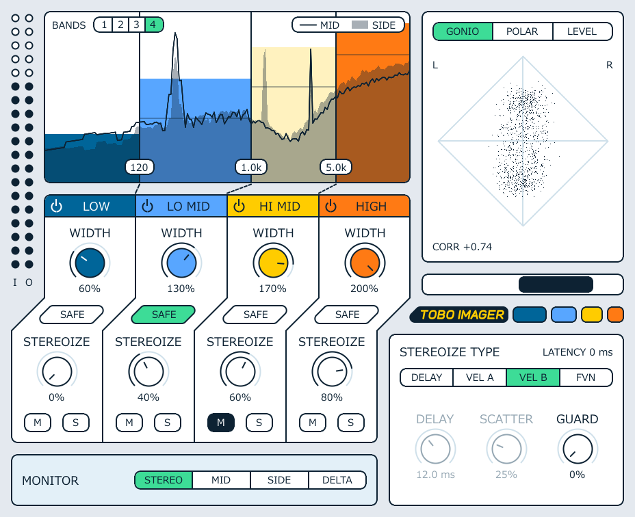

# Tobo Imager — stereo imager with one to four bands and a mono-compatible stereoizer

Tobo Imager is a free VST3 effect for Windows. It splits the sound into up to four frequency bands and sets the stereo width of each band. It can also make a mono sound wide (stereoize), and the mono sum of the result keeps the same spectrum as the mono sum of the input.

- **Format**: VST3, 64-bit Windows, stereo in and out
- **Price**: free
- **License**: AGPL-3.0-or-later (the source is in this repository)

<!-- Generated from manual/manual_en.md by tools/make_docs.py. Change the source, not this file. -->

**Download:** https://github.com/tobokegao/ToboImager/releases/latest  
**Demo video:** [tobo_imager_demo.mp4](https://github.com/tobokegao/ToboImager/releases/latest/download/tobo_imager_demo.mp4) (with the plugin switched off and on every four bars across three sounds)  
**日本語:** [README_ja.md](README_ja.md)

The full manual is also in the download as a PDF (`ToboImager_manual_en.pdf`; `ToboImager_manual.pdf` is the Japanese version).

## Documentation

- [Features](docs/features.md)
- [Install](docs/install.md)
- [Quick start](docs/quick-start.md)
- [The panel](docs/the-panel.md)
- [The stereoize types](docs/the-stereoize-types.md)
- [The stereo meters](docs/the-stereo-meters.md)
- [Parameters for automation](docs/parameters-for-automation.md)
- [Latency](docs/latency.md)
- [Tested environment and known limits](docs/tested-environment-and-known-limits.md)
- [Troubleshooting](docs/troubleshooting.md)
- [Building from source](docs/building-from-source.md)
- [License and credits](docs/license-and-credits.md)
- [Version history](docs/version-history.md)

## License

AGPL-3.0-or-later. See `LICENSE`, `CREDITS.md` and `THIRD_PARTY_LICENSES.txt`.
