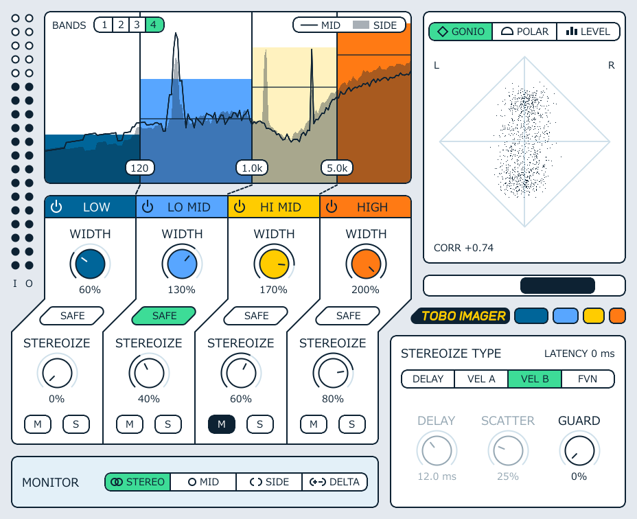
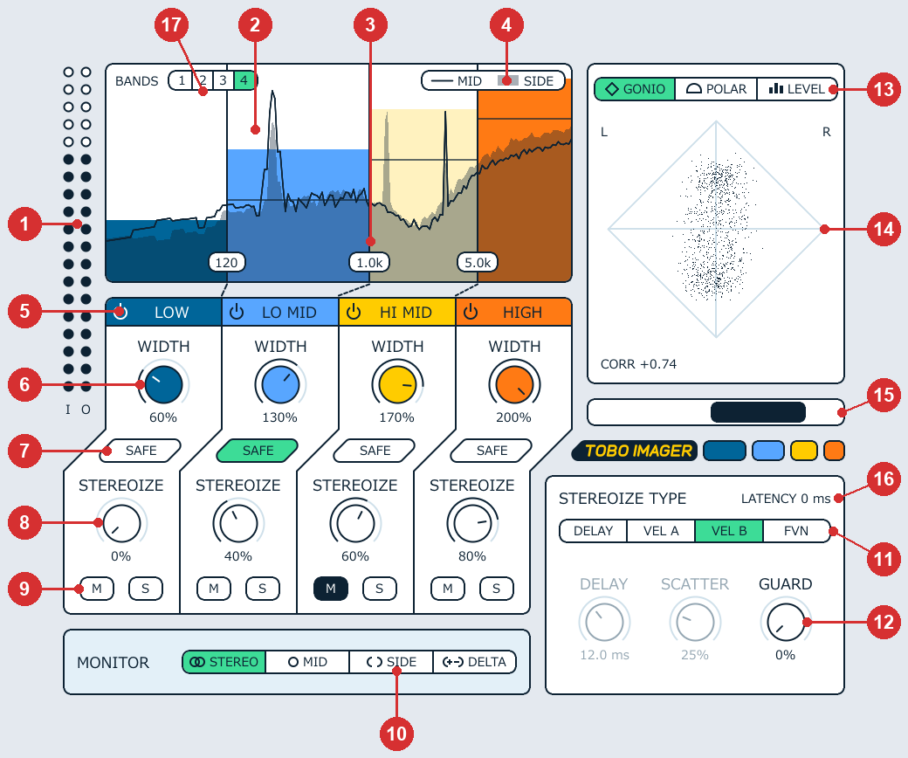
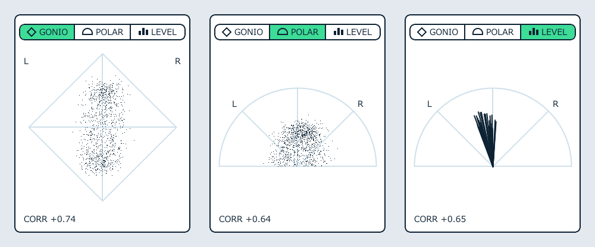

# Tobo Imager — 1〜4バンドに対応し、モノラル互換のステレオ化を備えたステレオイメージャー

<!-- manual/manual_ja.md から tools/make_docs.py が作るファイル。直すときは原稿を直して作り直す -->

Tobo Imagerは、Windows用の無料のVST3エフェクトです。音を最大4つの帯域に分け、帯域ごとにステレオの広がりを調整できます。モノラルの音を広げること（ステレオ化）もでき、広げたあとの音をモノラルに足し合わせると、スペクトルは入力をモノラルに足し合わせたものと同じになります。



- **形式**: VST3、64ビットWindows、ステレオ入出力
- **価格**: 無料
- **ライセンス**: AGPL-3.0-or-later（ソースコードはこのリポジトリにあります）

**ダウンロード:** https://github.com/tobokegao/ToboImager/releases/latest  
**デモ動画:** [tobo_imager_demo.mp4](https://github.com/tobokegao/ToboImager/releases/latest/download/tobo_imager_demo.mp4)（3種類の音で、4小節ごとにプラグインをオフ・オンしています）  
**English:** [README.md](README.md)

説明書はダウンロードしたZIPファイルにもPDFで入っています（日本語版は`ToboImager_manual.pdf`、英語版は`ToboImager_manual_en.pdf`）。

## 特長

- **1〜4バンド構成**: バンド数はBANDSで選びます。クロスオーバー周波数は、スペクトル表示の上でドラッグして動かします。クロスオーバーどうしは1/2オクターブ以上の間隔を保ち、隣のクロスオーバーに当たると、そのまま隣も一緒に動きます。帯域ごとにWIDTHとSTEREOIZEのノブがあります。
- **WIDTH（0〜200%）**: その帯域のサイド（左右の差の成分）のレベルです。0%でその帯域はモノラルになり、100%は入力のまま、200%でサイドが2倍（+6 dB）になります。
- **STEREOIZE（0〜100%）**: その帯域のミッド（左右の和の成分）からサイドを作り、モノラルの音に広がりを付けます。足される成分は左右で逆の極性なので、左右を足してモノラルにすると打ち消し合って消えます。
- **4種類のステレオ化方式**: DELAY（遅らせた音を1つ足す）、VEL AとVEL B（ベルベットノイズ。1つの反射音の代わりに、まばらな反射音をたくさん足す）、FVN（オールパスフィルター。4種類の中でいちばん滑らか。レイテンシーが発生します）。
- **ミッドのレベルを保持**: どの設定でも、ミッドのレベルは変わりません。加わるのはクロスオーバーのフィルターによる位相の回転だけで、ミッドとサイドに同じだけかかります。
- **SAFE（帯域ごと）**: その帯域のサイドをミッド以下のレベルに抑えます。入力の相関が0以上なら、どれだけ広げてもその帯域の相関は0より下がりません。
- **GUARD**: アタックの最初の数十ミリ秒をステレオ化から外し、アタックを中央に残します。
- **帯域・成分ごとのモニター**: 帯域ごとのソロとミュートに加えて、ミッドだけ、サイドだけ、設定によって変わった分だけを試聴できます（MONITOR）。
- **メーター**: ミッドとサイドのスペクトル、3種類のステレオメーター（GONIO・POLAR・LEVEL）、相関、入力と出力それぞれのサイドとミッドの比を表示します。
- **4段階のウィンドウサイズ**: 右クリックのメニューで1x・1.25x・1.5x・2xを選べます。

## インストール

1. [最新のリリース](https://github.com/tobokegao/ToboImager/releases/latest)から`ToboImager_0.1.2_win64.zip`をダウンロードして展開します。
2. `Tobo Imager.vst3`フォルダーを、中のファイルだけでなくフォルダーごと`C:\Program Files\Common Files\VST3\`にコピーします。
3. DAWを起動して、プラグインを再スキャンします。REAPERでは`Options` > `Preferences` > `Plug-ins` > `VST` > `Re-scan`です。
4. プラグインは**Tobo Imager**（Tobokegao）という名前で表示されます。

更新するときは、DAWを閉じてからフォルダーを新しいものに置き換えます。アンインストールするときは、フォルダーを削除します。プラグインはこのフォルダー以外に何も書き込みません。設定はDAWのプロジェクトに保存されます。

インストーラーも追加のランタイムも必要ありません。コード署名はしていません。

## 基本的な使い方

1. ステレオのトラックかバスにTobo Imagerを入れます。
2. **BANDS**でバンド数を選び、クロスオーバーのハンドルを帯域の境目にしたい位置までドラッグします。
3. すでにステレオの成分がある帯域を広げるには、その帯域の**WIDTH**を100%より上げます。狭めるとき（低域など）は100%より下げます。0%でモノラルになります。
4. モノラルの音に広がりを付けるには、広げたい帯域の**STEREOIZE**を上げます。ベースを中央に残したいときは、LOWの帯域を0%のままにします。
5. ステレオメーターと**CORR**を見ます。CORRが0より下がるときは、大きく広げている帯域の**SAFE**をオンにするか、ノブを下げます。
6. MONITORの**MID**を押すと、モノラルで再生したときの音を確認できます。

## 画面の各部



| 番号 | 名称 | 説明 |
|---|---|---|
| 1 | I / Oドットメーター | ミッドに対するサイドのレベルです。左の列（`I`）が入力、右の列（`O`）が出力です。ドット1つが3 dBで、いちばん上が+6 dB（サイドのほうがレベルが高い）、上から3つ目が0 dBです。 |
| 2 | スペクトル表示 | 出力のスペクトルです。ミッドは線、サイドは灰色の塗りで表示します。その後ろに、各帯域が色のブロックで表示されます。ブロックの高さはWIDTH（いちばん上が200%）で、STEREOIZEの量の位置（いちばん上が100%）に横線が入ります。オフ・ミュート中の帯域と、ソロ中にソロでない帯域は薄い色になります。 |
| 3 | クロスオーバーのハンドル | 帯域の境目になる周波数です。数はバンド数より1つ少なくなります。周波数の数字が付いたハンドルを左右にドラッグします。ハンドルどうしの間と、範囲の両端（20 Hzと20 kHz）との間には、1/2オクターブ以上の間隔が保たれます。そのため、クロスオーバーを設定できる範囲は29 Hz〜14.1 kHzです。隣のハンドルに当たると、隣のハンドルも一緒に動きます。 |
| 4 | MID / SIDEの凡例 | スペクトルの2つの曲線の描き方を示します。 |
| 5 | 帯域の見出し | 帯域の名前です。4バンドではLOW・LO MID・HI MID・HIGH、3バンドではLOW・MID・HIGH、2バンドではLOW・HIGH、1バンドではFULLになります。見出しをクリックすると、その帯域のオンとオフが切り替わります。オフの帯域は入力のまま通ります（WIDTH 100%、STEREOIZEなし）。 |
| 6 | WIDTH | その帯域のサイドのレベル（0〜200%）です。ノブは帯域の色です。 |
| 7 | SAFE | その帯域のサイドをミッド以下に抑えます（下の「SAFE」を参照）。 |
| 8 | STEREOIZE | その帯域のミッドからサイドを作る量（0〜100%）です。 |
| 9 | M / S | 帯域のミュートとソロです。ソロにできるのは一度に1帯域だけです。ソロにした帯域は、ミュートされていても聞こえます。 |
| 10 | MONITOR | STEREOは通常の出力、MIDはミッドだけ（左右を合わせたモノラル音）、SIDEはサイドだけです。DELTAは、設定によって足された分と減った分だけを出します。出力から、全帯域をWIDTH 100%・STEREOIZEなし・ミュートなしにしたときの音を引いたものです。何も変えていなければ、DELTAは無音になります。選択中のMID・SIDE・DELTAをもう一度クリックするとSTEREOに戻ります。 |
| 11 | STEREOIZE TYPE | DELAY・VEL A・VEL B・FVNから選びます（下の「ステレオ化の方式」を参照）。 |
| 12 | DELAY / SCATTER / GUARD | DELAYはDELAY方式の遅延時間（2〜30 ms）、SCATTERはFVN方式のランダムな成分の量、GUARDはどの方式でも使えるトランジェントガードです。選んだ方式で使わないノブは薄い色になり、操作できません。 |
| 13 | メーターのボタン | ステレオメーターの種類（GONIO・POLAR・LEVEL）を選びます。 |
| 14 | ステレオメーター | 下の「ステレオメーター」を参照。 |
| 15 | CORRと相関バー | 左右の相関です。+1はモノラル、0はサイドとミッドが同じレベル、0より下はサイドのほうがレベルが高い状態です。バーは同じ値を、中央（0）から右（+1）または左（−1）へ伸ばして表示します。 |
| 16 | LATENCY | プラグインがDAWに報告している遅延です。FVN方式以外では0 msです。 |
| 17 | BANDS | バンド数（1〜4）です。バンド数を減らすと、高いほうの帯域から外れ、残った帯域のうちいちばん上の帯域が20 kHzまでを受け持ちます。残った帯域の設定は変わりません。外れた帯域の設定もそのまま保たれており、バンド数を元に戻すと設定も戻ります。使っていないクロスオーバーのフィルターは、信号の経路から外れます。バンド数を増やすとき、いちばん上のクロスオーバーより上に空きがない場合は、そのクロスオーバーと下のクロスオーバーが低いほうへ移動して空きを作ります。 |

### マウスの操作

- **ノブ**: 上下にドラッグします。`Shift`を押しながらドラッグすると細かく動きます。ダブルクリック（または`Ctrl`+クリック）で初期値に戻ります。
- **クロスオーバーのハンドル**: 縦の線か、周波数のラベルを左右にドラッグします。隣のハンドルに当たると、隣のハンドルも一緒に動きます。ドラッグして戻しても、隣のハンドルは動かされた位置に残ります。
- **画面のどこかで右クリック**: サイズのメニュー（1x・1.25x・1.5x・2x）とバージョン番号が表示されます。サイズはプロジェクトに保存されます。

プラグインがバイパスされているとき、またはDAWがプラグインの処理を止めているときは、画面全体が薄い色になり、メーターは空になります。操作はできます。

## ステレオ化の方式

4種類とも、STEREOIZEのノブで決めた量だけ、帯域ごとにミッドからサイドを作ります。違うのは、その途中でミッドに何をするかです。

- **DELAY**: ミッドをDELAYの時間（2〜30 ms）だけ遅らせた音を1つ使います。昔からある方法です。左右それぞれの耳には規則的なくし形の周波数特性（コムフィルター）が付き、遅延が長いと、鋭いアタックで反射音として聞こえます。レイテンシーはありません。
- **VEL A**（初期設定）: ミッドを、30 msの中にまばらに並んだ30個の減衰するインパルス（ベルベットノイズ）に通します。インパルスの位置とレベルには、左右それぞれの耳で周波数特性がほぼ平らになる値を選んであります。1つの反射音としては聞こえず、規則的なくし形にもなりません。レイテンシーはありません。
- **VEL B**: VEL Aの減衰を速くしたものです。余韻が短く、アタックが鋭くなり、低域の広がりは少し減ります。レイテンシーはありません。
- **FVN**: オールパスフィルターです。サイドの位相を90度回すので、どの周波数でも左右の耳にミッドと同じレベルの音が届きます。そこに、SCATTERで量を決めるランダムな成分を加えます。このフィルターの応答は音の前と後ろへ均等に広がるため、プラグインは全体を遅らせる必要があります。遅延は44.1〜96 kHzで約33〜36 msです。再生と書き出しでは、DAWがこの遅延を補正します。プラグインを通した音を聴きながら演奏するときは、ほかの方式を使ってください。

FVN方式では、ステレオ化の量がフィルターそのものに入っています。そのため、STEREOIZEのノブ、クロスオーバー、SCATTERを動かすたびにフィルターを作り直します。再生中に動かすと、小さなクリックノイズが出る場合もあります。

### GUARD（トランジェントガード）

新しいアタックが来たとき、最初の数十ミリ秒のあいだ、ステレオ化に入る音を小さくします。アタックは中央に残り、そのあとに続く部分だけが広がります。0%でオフです。1 ms先の音を見て動作します。DELAY方式とベルベットノイズ方式では、これによるレイテンシーはありません。

### SAFE

帯域を大きく広げると、サイドのレベルがミッドより高くなり、その帯域の相関が0より下がります。SAFEは、オンにした帯域でこれを防ぎます。帯域のミッドとサイドの大きさを、約30 msの幅で測ります。そして、プラグインが足している分（100%を超えるWIDTHとSTEREOIZE）を、サイドがミッド以下に収まるところまで下げます。

- 帯域を入力より狭くすることはありません。
- FVN方式では、下げられるのはWIDTHの分だけです。
- 帯域ごとに働きます。全体の相関は、帯域ごとの相関より低くなることがあります。

## ステレオメーター



- **GONIO**: サンプルを1つずつ点で描きます。上下がミッド、左右がサイドです。モノラルの音は縦の線になり、広い音はひし形いっぱいに広がります。横に広がった形は、サイドのレベルがミッドより高い状態です。
- **POLAR**: 同じ点を半円に折りたたんで描きます。真上がモノラル、45度が左または右いっぱいで、半円の底辺に近い点はサイドのレベルがミッドより高い状態です。
- **LEVEL**: 音を短い区間に分け、区間ごとに1本の線を描きます。線の角度はその区間が左右のどこにあるか、長さはレベルを表します。

表示は最大の点に合わせて拡大されます。そのため、音の広がり方は分かりますが、音量は分かりません。

## オートメーションのパラメーター

DAWに表示される名前です。

| パラメーター | 範囲 | 初期値 |
|---|---|---|
| Bands | 1、2、3、4 | 4 |
| Crossover 1 / 2 / 3 | それぞれ20〜20000 Hz | 120 / 1000 / 5000 Hz |
| Band 1 / 2 / 3 / 4 Width | 0〜200% | 100% |
| Band 1 / 2 / 3 / 4 Stereoize | 0〜100% | 0% |
| Stereoize Delay | 2〜30 ms | 12 ms |
| Stereoize Type | Delay、Velvet A、Velvet B、FVN | Velvet A |
| Transient Guard | 0〜100% | 0% |
| FVN Scatter | 0〜100% | 25% |
| Solo Band | Off、Band 1、Band 2、Band 3、Band 4 | Off |
| Monitor | Stereo、Mid、Side、Delta | Stereo |
| Band 1 / 2 / 3 / 4 On | オフ、オン | オン |
| Band 1 / 2 / 3 / 4 Mute | オフ、オン | オフ |
| Band 1 / 2 / 3 / 4 Safe | オフ、オン | オフ |

Band 1がいちばん低い帯域です。DAWからは、どのクロスオーバーも20 Hz〜20 kHzのどの値にも設定できます。1/2オクターブの間隔が保たれるのは、画面のハンドルを操作したときだけです。バンド数が4より少ないとき、使っていない帯域とクロスオーバーのパラメーターは、音に影響しません。使っているクロスオーバーの順番をDAWが入れ替えて設定した場合、プラグインは周波数の低い順に並べ直して使います。クロスオーバーの周波数を変えたとき、フィルターはすぐには切り替わらず、100分の数秒ほどで新しい値に移ります。

ウィンドウのサイズとステレオメーターの種類は、プロジェクトに保存されますが、パラメーターではありません。

## レイテンシー

| ステレオ化の方式 | レイテンシー |
|---|---|
| DELAY、VEL A、VEL B | 0 |
| FVN | 44.1 kHzで1579サンプル（35.8 ms）、48 kHzで1583サンプル（33.0 ms）、96 kHzで3167サンプル（33.0 ms） |

プラグインはレイテンシーをDAWに報告し、DAWがそれを補正します。FVN方式とほかの方式を切り替えると、報告するレイテンシーが変わります。このとき、DAWによっては音が一瞬途切れます。

## 動作確認環境と制限事項

- **動作確認済みの環境**: Windows 11、REAPER 7.85、48 kHz、画面の拡大率100%。
- **未確認の環境**: ほかのDAW、100%以外の画面の拡大率、48 kHz以外のサンプルレート。
- クロスオーバーは、サンプルレートの0.45倍より下に制限されます。44.1 kHz以上では、少なくとも19.8 kHzまで設定できます。
- 音は測定で確認しました。移植元のJSFX版と出力を比べ、15通りの設定で差は−190 dB以下でした。
- プラグインにプリセットはありません。DAWのプリセット機能を使ってください。
- FVN方式では、設定を変えたときのフィルターの作り直しを、音を処理するスレッドで行います（上記）。
- 文字には、Windowsに入っているフォントMeiryo UIを使います。

うまく動かないときは、DAWの名前とバージョンを添えて[issue](https://github.com/tobokegao/ToboImager/issues)でお知らせください。

## 困ったとき

| 症状 | 確認事項と対処 |
|---|---|
| DAWにプラグインが表示されない | `Tobo Imager.vst3`フォルダーが、フォルダーごと`C:\Program Files\Common Files\VST3\`に入っているかを確認し、プラグインを再スキャンします。プラグインは64ビット専用です。 |
| モノラルにすると、ステレオのときより音量が大きく下がる | モノラルに足すとサイドは消え、ミッドだけが残ります。プラグインはミッドを変えません。サイドのレベルがミッドより高い（CORRが0より下）と、ステレオで聞こえている音の大部分がモノラルでは消えます。広げている帯域のSAFEをオンにするか、WIDTHとSTEREOIZEを下げます。 |
| STEREOIZEを上げても音が変わらない | 帯域がオフになっている（帯域の見出しで切り替え）か、MONITORがMIDになっています。STEREOIZEはミッドから作るので、サイドにしかない音には何も足されません。 |
| 音が遅れて聞こえる | FVN方式を選んだトラックを、演奏しながら聴いています。DELAY・VEL A・VEL Bのどれかを選びます。 |
| 画面が薄い色になり、メーターが空になる | プラグインがバイパスされているか、DAWがプラグインを処理していません（DAWによっては、無音のトラックの処理を止めます）。 |
| ウィンドウが小さすぎる・大きすぎる | 画面のどこかで右クリックして、サイズを選びます。 |

## ソースからのビルド

Visual Studio 2022以降（またはBuild Tools）のC++のワークロードと、CMakeが必要です。

```
git clone https://github.com/tobokegao/ToboImager.git
cd ToboImager
git clone --depth 1 --branch 9.0.5 https://github.com/juce-framework/JUCE.git
cmake -S . -B build -A x64
cmake --build build --config Release --parallel
```

プラグインは`build/ToboImager_artefacts/Release/VST3/Tobo Imager.vst3`にできます。

- `Source/Engine.h`: 音の処理。
- `Source/PluginProcessor.*`: パラメーター、状態の保存、レイテンシーの報告。
- `Source/PluginEditor.*`: 画面。画像に1画素ずつ描いています。
- `test/panel_shot.cpp`: `PanelShot.exe`になります。DAWを使わずに、4つのサイズの画面をPNGに書き出し、マウスの操作を模擬して各部品を動かします。
- `test/stress.cpp`: `StressTest.exe`になります。通常は使わないサンプルレート、不正な値を含む入力、壊れた保存データをプラグインに与え、マウスをランダムに操作して、異常が起きないことを確認します。
- `manual/`と`tools/make_docs.py`: この説明書の原稿と、そこから`README.md`・`README_ja.md`・`docs/`・PDFを作るスクリプト。

## ライセンスとクレジット

Tobo Imagerは、GNU Affero General Public Licenseバージョン3またはそれ以降（`LICENSE`）で公開しているフリーソフトウェアです。Copyright (C) 2026 tobokegao.

JUCEフレームワーク（AGPLv3）とVST 3 SDK（MIT License）を使っています。VSTはSteinberg Media Technologies GmbHの登録商標です。ステレオ化の方式のもとになった論文と、バイナリに含まれるライブラリのライセンスは、`CREDITS.md`と`THIRD_PARTY_LICENSES.txt`にあります。

## 更新履歴

### 0.1.2（2026-11-17）

- メーターのボタン（GONIO・POLAR・LEVEL）とMONITORのボタン（STEREO・MID・SIDE・DELTA）の名前の左に、小さな絵の記号を追加しました。英語が読めなくてもボタンを見分けられます。
- スペクトル表示でSTEREOIZEの量を示す横線を濃くしました。
- メーターのボタンとMONITORのボタンの幅を少し広げました。

### 0.1.1（2026-11-17）

- 帯域の見出しの電源マークを修正しました。2xのサイズでは、縦棒が輪の中央より0.5ピクセル左にずれていました。1.25x・1.5x・2xのサイズでは、輪のいちばん下の部分がほかより薄くなっていました。

### 0.1.0（2026-11-17）

- 最初の公開。
