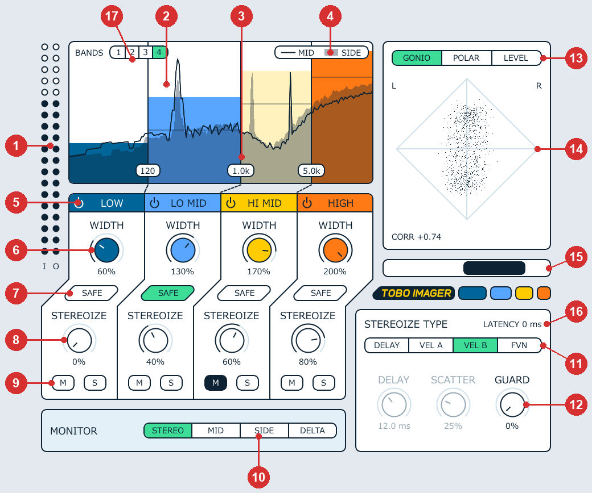

[Tobo Imager](../README.md) › The panel

<!-- Generated from manual/manual_en.md by tools/make_docs.py. Change the source, not this file. -->

## The panel

| No. | Part | What it does |
|---|---|---|
| 1 | I / O dot meter | The level of the side relative to the mid, going in (`I`, left column) and coming out (`O`, right column). One dot is 3 dB; the top dot is +6 dB (side louder than mid), the third dot from the top is 0 dB. |
| 2 | Spectrum display | The spectrum of the output: the mid as a line, the side as a grey fill. Behind it, each band is a coloured block as high as its WIDTH (full height = 200 %), with a line across it at its STEREOIZE amount (full height = 100 %). A band that is switched off, muted or not soloed is shown pale. |
| 3 | Crossover handles | The frequencies where the bands meet: one fewer than the number of bands. Drag a handle (showing its frequency) sideways. The handles stay at least half an octave apart from each other and from the two ends of the range (20 Hz and 20 kHz), so a crossover can be set from 29 Hz to 14.1 kHz. A handle that is dragged against its neighbor pushes the neighbor along. |
| 4 | MID / SIDE legend | Shows how the two curves of the spectrum are drawn. |
| 5 | Band header | The name of the band. With four bands: LOW, LO MID, HI MID, HIGH. With three: LOW, MID, HIGH. With two: LOW, HIGH. With one: FULL. Click the header to switch the band off or on. A band that is off passes audio through unchanged (WIDTH 100 %, no STEREOIZE). |
| 6 | WIDTH | The side level of the band, 0–200 %. The knob has the colour of the band. |
| 7 | SAFE | Holds the side of this band at or below its mid (see “SAFE” below). |
| 8 | STEREOIZE | How much side is made out of the mid of this band, 0–100 %. |
| 9 | M / S | Mute and solo of the band. Only one band can be soloed at a time. A soloed band is heard even if it is muted. |
| 10 | MONITOR | STEREO = the normal output. MID = only the mid (what a mono sum gives). SIDE = only the side. DELTA = only what the settings add or take away: the output minus what would come out with every band at WIDTH 100 %, no STEREOIZE and nothing muted. With nothing changed, DELTA is silent. Click MID, SIDE or DELTA again to go back to STEREO. |
| 11 | STEREOIZE TYPE | DELAY, VEL A, VEL B or FVN (see “The stereoize types” below). |
| 12 | DELAY / SCATTER / GUARD | DELAY: the delay time of the DELAY type, 2–30 ms. SCATTER: the size of the random part of the FVN type. GUARD: the transient guard, for every type. A knob the chosen type does not use is pale and cannot be turned. |
| 13 | Meter buttons | The kind of stereo meter: GONIO, POLAR or LEVEL. |
| 14 | Stereo meter | See “The stereo meters” below. |
| 15 | CORR and correlation bar | The correlation of left and right: +1 = mono, 0 = side and mid equally loud, below 0 = more side than mid. The bar shows the same value from the middle (0) to the right (+1) or left (−1). |
| 16 | LATENCY | The delay the plugin reports to the DAW. 0 ms except with the FVN type. |
| 17 | BANDS | The number of bands, 1 to 4. With fewer bands, the highest bands are removed and the top band that remains reaches up to 20 kHz. The remaining bands keep their settings. The settings of a removed band are kept and come back with the band. The filters of a crossover that is not in use are taken out of the signal path. When a band is added and there is no room above the highest crossover, that crossover and any below it move down to make room. |

### Mouse

- **Knob**: drag up or down. Hold `Shift` for fine control. Double-click (or `Ctrl`+click) resets it to the default value.
- **Crossover handle**: drag the line or its frequency label left or right. A handle that reaches its neighbor pushes the neighbor along. When the handle is dragged back, the neighbor stays where it was pushed to.
- **Right-click anywhere**: the size menu (1x, 1.25x, 1.5x, 2x) and the version number. The size is saved in the project.

When the plugin is bypassed, or the DAW has stopped processing it, the whole panel is shown pale and the meters are empty. The controls still work.

---

← [Quick start](quick-start.md)   |   [Contents](../README.md#documentation)   |   [The stereoize types](the-stereoize-types.md) →
