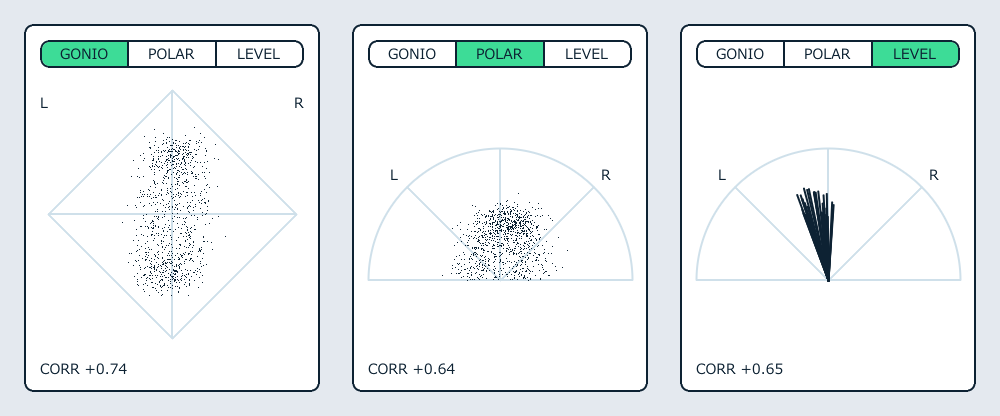

[Tobo Imager](../README.md) › The stereo meters

<!-- Generated from manual/manual_en.md by tools/make_docs.py. Change the source, not this file. -->

## The stereo meters

- **GONIO**: every sample as a dot. Up–down is the mid, left–right is the side. A mono sound is a vertical line; a wide sound fills the diamond; a sound lying flat has more side than mid.
- **POLAR**: the same dots folded into a half disc. Straight up is mono, 45 degrees is hard left or right, and dots near the floor have more side than mid.
- **LEVEL**: one ray for each short piece of the sound. The angle shows where the piece sits between left and right, the length how loud it is.

The picture is scaled to the loudest point, so it shows the shape of the sound, not its level.

---

← [The stereoize types](the-stereoize-types.md)   |   [Contents](../README.md#documentation)   |   [Parameters for automation](parameters-for-automation.md) →
